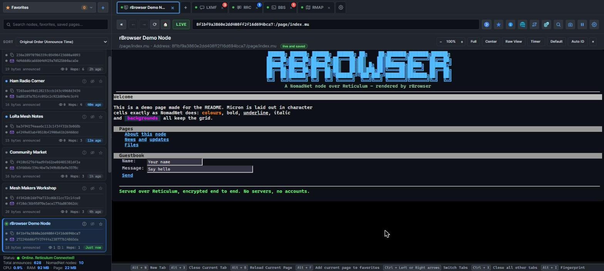
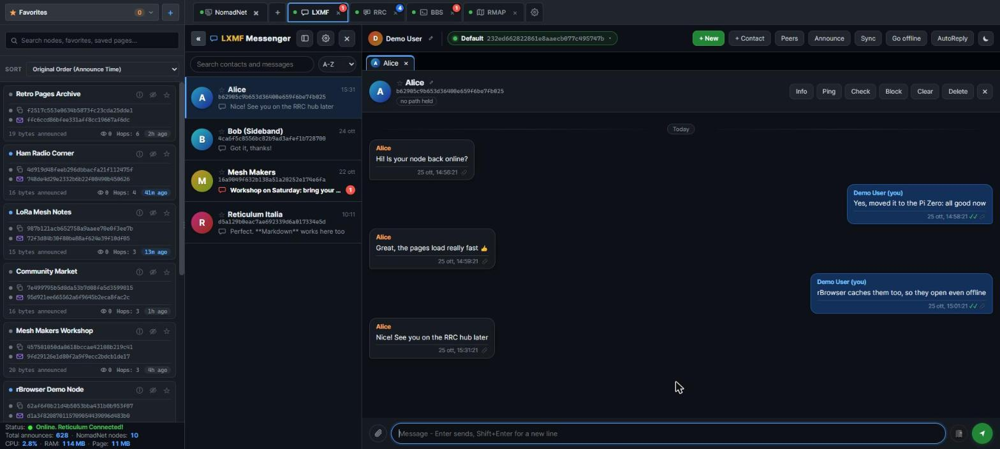
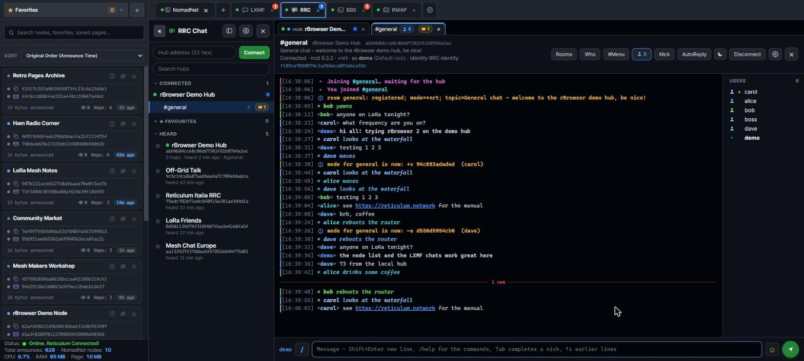
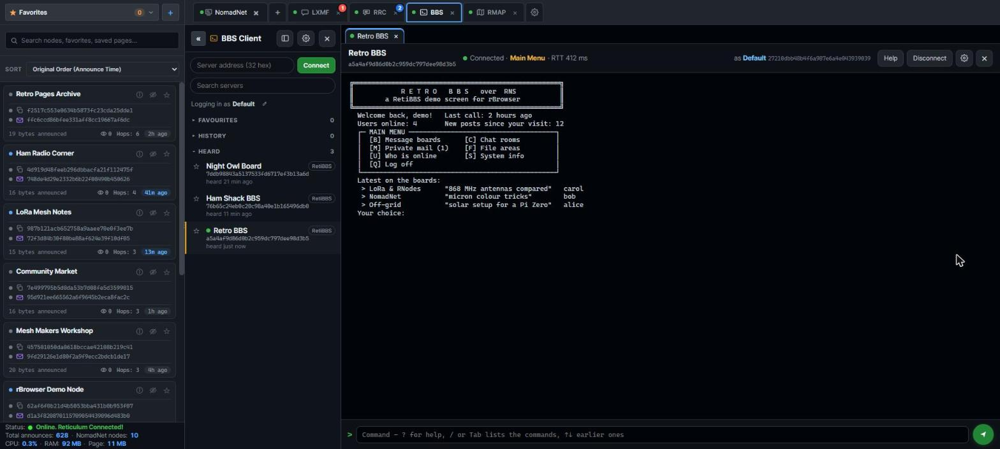

# rBrowser2: Standalone Reticulum Browser

A modern, web-based UI for exploring NomadNet nodes and pages over the Reticulum network, with LXMF, RRC, BBS Clients and integrated RMAP.WORLD support for external nodes discovery.



---

<div align="center">

[](LICENSE)
[](https://www.python.org/)
[](https://www.docker.com/)
[](http://localhost:5000)
[](https://github.com/markqvist/Reticulum)
[](https://github.com/fr33n0w)

</div>


> **Beta - v2.0.5b.** rBrowser 2 is published as a beta: everything works, but
> some parts of the interface may still have bugs. They are fixed as soon as
> possible. To hear about updates, switch on *Settings > About > Check for
> updates at start* (a window tells you when a new version is out, with the
> link to this page), or press *Check now* there.

## New in version 2.0+

Version 2.0 is a substantial refactor rather than a feature release. The
goal was a browser that renders a NomadNet page the way NomadNet renders it,
and that behaves on the network the way a well-mannered Reticulum client
should.

**Rendering now matches NomadNet.** Micron is laid out in character cells,
and several defects were quietly breaking that grid: runs of spaces were
collapsing, so artwork drawn with background-coloured spaces lost its shape;
the line height left a fifth of every row unpainted, which showed up as dark
scanlines through block art; every coloured run was padded by two pixels,
which pushed the columns out of alignment; and the cell width was a hardcoded
guess at the font's advance rather than the real thing. With those fixed, the
separate "ASCII mode" and its auto-detection became redundant and were
removed - the normal rendering path is now the faithful one.

**Support for current NomadNet.** Page partials, inline images over the
node's /media handler, tables, collapsible sections, anchors, and multi-row
input fields are all rendered. Request parameters follow the protocol's own
distinction between link literals and form fields, instead of sending both
spellings of every value and hoping. When a form request fails, the error
shows the path that was asked for along with the parameters, so a link that
points to a page the node does not have is easy to spot. File downloads interpret the three
response shapes a node can send, including the case where a refusal arrives
as a Micron page rather than a file.

**Timeouts come from the network, not from a stopwatch.** The old fixed
thirty seconds was generous over TCP and far too short over LoRa, where a
single hop can take most of that. Timeouts are now derived from the real path
cost that RNS reports, so a slow node is waited for rather than declared
dead. Ping measures the link round-trip time instead of downloading the
node's front page.

**The page crawler has been removed.** Earlier versions shipped a search
engine fed by a background crawler. It was off by default and had to be
switched on by hand, but once enabled every node that announced had its
index requested automatically, and an option extended that to a list of
further pages. Over TCP this only added useless traffic, but over LoRa it
used up shared airtime that other users of the network need. Now rBrowser
only requests the pages you open yourself.

**What replaced it: a cache of the pages you have read.** NomadNet keeps a
copy of the pages it fetches, and so does rBrowser now. A page you open is
written to disk; the next time you open it, it appears immediately and
nothing goes over the radio - for as long as the node allows, as in NomadNet
(see below). The header says which happened - `live` or `from cache`, with
the age of the copy - so a fast load is never mistaken for a fast node.
Reload always goes to the node, whatever the setting. If a node has gone
offline, the stored copy is shown rather than an error page, labelled as
such.

Because those pages are on disk, they can be searched: the **Local Search
Engine** (magnifier button in the top bar, or the empty tab; in a window or, Settings >
NomadNet Browser, in a tab of its own that fits the window and whose results
open in new tabs; it searches while you type, x clears it, "show" sets how many results; the window/tab choice is kept on the server, the same from every address) looks through everything you have read, by text, title, node name or
path. It is a search engine over your own history, and the distinction from
the old crawler is the whole point - it cannot reach the network at all, so
it can only find what you went and looked at yourself.

The cache is on by default and entirely under your control in Settings:
whether pages are stored, whether stored pages are served, an age limit, a
size limit, and a button to delete the lot. Pages live under `cache/pages`,
one directory per node, as plain Micron files you can read with anything.

**Who runs a node.** The node list shows the operator's LXMF address under
each node's hash, with a copy button. It is not announced and it is not
asked for: NomadNet builds a node's destination and its operator's LXMF
destination from the same identity, so the address falls out of the announce
already received. The operator's name appears alongside it if they also
announce on LXMF, which rBrowser listens for passively. The envelope icon
copies the address; a click on the address opens the LXMF menu, where you can
write to the operator with rBrowser's own messenger (when switched on in
Settings > LXMF Messenger), add them to your contacts or check if they are
reachable.

**Several identities.** Browsing is anonymous: a node only learns who you are
when you identify to it (the fingerprint), and it keys accounts on that
identity. In Settings you can keep several identities, switch between them,
import and export them, and use an **ephemeral** one: a throwaway key kept
only in memory, replaced at every start, at every press of reload, or on a
timer (every 30 s to 1 h, without reloading the page). "Keep"
saves it as a normal identity, the only way back to accounts made with it.
Your existing `nomadnet_browser_identity` is the default one, unchanged.
Pages seen while identified are never stored in the page cache.

**Custom address generator.** Settings > Identity > Generate vanity address:
a new identity whose LXMF address (or, for RRC, identity hash) starts or
ends with characters you choose (`c0ffee…`, `…c0ffee`). It runs in the background on the computer that runs rBrowser;
each character more takes 16 times longer (on a PC: 5 in seconds, 6 in
minutes), so keep it short on a Raspberry Pi. Save it, use it, or export it
for another app.

**Auto-identify.** Each node remembers the identity you first identified to it
with. Switched on, rBrowser sends the fingerprint on its own, with that
identity, when you open one of its pages - once per node per session. If a
different identity is in use, it asks before switching.

**Reticulum interfaces.** Always watched, nothing is sent: when an interface
to the network goes down (a TCP link lost, a phone out of coverage) or comes
back, a line in the terminal; with none of them up the status bar says
"Reticulum interface disconnected" in red. An RNode on the air with no
internet keeps Reticulum connected.

**Internet check.** Settings > System Setup, off by default. When on, rBrowser
checks every 15 seconds, with a
time server (NTP, one small UDP packet, the default: `pool.ntp.org`) or a
connection to hosts you choose (nothing is sent), and says when the internet
goes away and comes back: a line in the terminal, "No internet connection" in
red in the status bar, a notification. Test asks each server in the list at
once, so a dead server is not taken for a dead line. While it is away, what uses the internet by itself waits
instead of filling the log with errors (update check, RMAP download, Dynamic
DNS) and goes on when it is back. NomadNet, LXMF and RRC go on as usual: they
run over Reticulum, which may also have radio links. Off, nothing is contacted.

**Web server settings.** `--host` and `--port` can also be set in Settings.
A change needs a restart: rBrowser offers to do it, restarts itself and the
page reconnects on its own. Started in a terminal, it stays in that terminal
after the restart, and Ctrl+C still stops it. Options typed on the command line still win when
you start rBrowser by hand.

**Local network name.** In the same place, turn on a name like
`rbrowser.local`: phones and computers on your home network open
`http://rbrowser.local:5000` without the IP. It is announced with mDNS
(zeroconf, installed with the requirements) and applies at once. Only when
rBrowser listens on the network (`0.0.0.0`). Anyone on that network can open
it: turn on the access password (Settings > System Setup) to keep them out.

**Links from anywhere.** `nomadnetwork://`, `rrc://` and `rbrowser://` links
on web pages (rmap.world's "Open in rBrowser2") and in other programs open in
rBrowser, which starts if it is not running. On by default for the links no
other program opens; Settings > System Setup > Links turns them off. A link holds
NomadNet's own syntax: `<hash>:/page/...` opens the page, `lxmf@<hash>` the
messenger, `rrc://<hub>/<room>` the chat, `retibbs.bbs@<hash>` the BBS
client, `lxmf.propagation@<hash>` offers it as your propagation node. Only
well formed links open; joining a hub or a BBS from a link is asked first.
With rBrowser already open on that computer, the link opens in that page and
its browser window comes forward (when rBrowser is not the tab on screen, its
tab title blinks). Windows and Linux with a desktop; from the terminal,
`--register-links` / `--unregister-links`.

**Settings.** Grouped in categories (Identity, Pages, NomadNet Browser,
LXMF Messenger, RRC Client, BBS Client, RMAP, System, Advanced, About) with a search box over all of them; one Save
writes every category. A changed category gets a dot, and closing with
changes not saved asks Save / Discard / Keep editing. Changing host or port
marks System in amber and says a restart is needed, offered after saving.
Identity, Links, Restore and Unblock apply at once.

**Start with recent nodes.** Off by default: the node list fills as nodes
announce, so all of it was heard since rBrowser started. On (Settings > Node
list, 1 to 24 hours), it starts with the NomadNet nodes Reticulum already
heard announce within that time, read from its known announces - nothing is
sent. They show an empty violet ring instead of the dot until they announce
again: they may be offline.

**Interface font.** The interface is in Inter (bundled); addresses, hashes,
the status and shortcut bars and NomadNet pages stay in Cascadia Mono.

**Downloads and images.** File links with variables
(`:/file/artifact`a=Manual.pdf`) and nodes that serve files only to
identified users now work. Closing the download box cancels the transfer.
Image sizes (`w=`, `h=`) are columns and rows, as in NomadNet.

**Full screen and zoom.** The Full button shows only the page, with a one
line bar (title, address, close). Esc leaves. The default zoom is set
separately for desktop and mobile in Settings.

**Safety and reliability fixes.** Node names come from announces, so from
anyone: they are now escaped everywhere they are shown, including inside
attributes (a crafted name could run script in the page before). Pages
opened quickly in several tabs no longer land in the wrong tab or come up
blank. Shortcuts no longer fire while you type (Ctrl+X cuts again).
Notifications stack instead of covering each other, and a page load says
which node and page it was. The node list scrolls to the selected node. On
phones the nav bar is two rows, buttons and address bar, and nothing runs
off the screen.

**Brackets in pages.** The Micron parser shared with MeshChat took any
`[...]` as a link, even without the backtick in front. Pages that forgot it
showed menus as `BOARD]  ::  ABOUT]`, and plain text such as `[1]` or
`[note]` turned into dead links. Now a bracket without the backtick is text,
as in NomadNet, unless it clearly is a link (`[label`:/page/x.mu]`), in which
case it is shown with both brackets: `[BOARD]`.

**Interface.** The node list updates in place instead of being rebuilt, so it
no longer jumps while you are reading it. The sidebar can be dragged to any
width or hidden entirely. Page zoom and centring are under your control and
are remembered. The mobile layout keeps pages in shape instead of reflowing
them.

**Cache, the NomadNet way.** A saved page stands in for the live one only as
long as the node allows: the `#!c=<seconds>` first line of the page, 12 hours
without it, never for `#!c=0` (dynamic pages). Partials are always fetched
live. Pages are saved byte for byte (on Windows, pages with CRLF line ends
came back with a blank line under every line). A label before the address
bar says **LIVE**, **CACHE** (with its age; click for the live page) or
**OFFLINE COPY**; hover it for why. The node info panel lists the node's
saved pages and what the next visit to each will do.

**Node list.** Each card shows the hops to the node (hover: the interface the
path leaves by; click: node info), how many times you opened it, and how
many of its pages are saved - with a ring around the dot when they would open
from the cache. New sort: **Most Visited by You**; every sort keeps up as
nodes announce, and the sort you chose is kept in `settings/node_list.json`,
so it is the same after a restart and from any address rBrowser is opened
at. While the pointer is on the list it holds still. An "N new
nodes" button appears while new nodes (under Recent and Most Frequent also
re-announced ones) are out of view, above or below as the sort puts them:
click it to go to them, scroll to them yourself, or close it. It can be
turned off in Settings. New cards flash a blue border for 2 s. At the top of
the list, new nodes come in without moving it. The node you are visiting stays
in place on screen while the list changes around it. Opening a node no
longer adds it to the list: the answer to a path request is an old copy of
its announce, not an announce.

**Favorites.** Added from a dialog. With no name given, the name is looked up
on the network and filled in when it arrives; choose whether your own name
or the node's wins. Settings > Favorites turns the menu and the stars on or
off (on by default; the list is kept either way) and, with "Update names from
the node's newest announce" (on by default), a node that renames itself
renames its favorite too. Off, a name never changes once it is there.

**History.** Beside Favorites, the pages you opened, newest first. Off by
default; in Settings: on or off, how many pages to keep, and whether to delete
the older ones on their own (1, 7 or 30 days). Kept in `settings/history.json`.

**Also new.** Pages are drawn on pure black, as in a terminal. Centring now
works on pages with long paragraphs or dividers. The reload button spins
while a page loads. A **screenshot** button (nav bar, and the full screen
bar) saves the whole page as a PNG. Settings > Screenshots turns it off and
sets the quality, one for desktop (Medium) and one for phones (Low, faster).
New tabs open at the end of the pages, before the "+"; then come the app
tabs (Messages, RRC, BBS, RMAP) and, on desktop, a ⚙ that opens Settings.
With many tabs open, scroll the row with the mouse wheel or drag it sideways.

**Pages that fit the screen.** Fit keeps text at full size: a long line
without drawing wraps, and only an ASCII block too wide for the screen
shrinks, each block just enough (text tables never under 5px, drawings - box,
block or braille art - down to 2px). A line of text too long even at 5px (a
long link with no spaces) wraps on its own. Stray spaces past the edge no longer
scroll the page sideways. On a phone pages fit without the Center button, and
pinch zoom still works. Pages with CRLF line ends no longer get a step in
their last row.

**Fit on real phones.** Android browsers enlarge text with the system font
size and never draw it below a minimum (8px in the WebView): art set smaller
stayed wide and dragged the page sideways. Fit measures both on the device
and scales what must go below the minimum. A last check on screen catches
any line still past the edge. Images fit on their own and no longer stretch
the page. Partials that refresh (an animated header) no longer move the page
while you scroll it.

**Search everything you know.** The sidebar search looks through the node
list (name, hash, operator, LXMF address), your favorites and the text of
your saved pages, and shows matching favorites and pages above the list. Type
a name in the address bar instead of an address and the same search offers
suggestions: arrows and Enter, or a click. Opening a result clears the
search and brings the whole list back; Settings > NomadNet Browser > Node list keeps it instead.
Above the list: Favorites and History, then search, then sort. A saved page
found shows three lines: the node's name, the page (title and path), and the
words found in it. Titles and snippets are the page's readable text: no
`#!` headers, no Micron tags, no Braille or box-drawing art (a logo was
showing up as the title of whole nodes). Esc empties
the search, the address bar and the Messages search, and each has a × to
clear it with the mouse.

**Request path.** A button in the nav bar, in the node info panel and in a
failed ping forgets the path to the node (in rBrowser and in the shared
instance, like `rnpath -d`) and asks the network for a new one, then says
what changed. For a node that has announced and still cannot be reached.

**Node list.** A click anywhere on a card opens the node. Right-click it, or
long press on a phone, for a menu: open, open in a new tab (or in background,
staying on the page you read), info, copy, ping,
check path (hops, next hop, age and expiry of the path held, nothing sent),
request path, favorite, hide, remove from cache (the next visit goes live; the
label of an open page updates). The operator's LXMF address has its own menu,
on click with the mouse and on long press on a phone, where a tap opens the
node like the rest of the card: open the messenger, send a message, copy it,
and the same actions as a conversation (info, ping, check if reachable with
one path request, block, delete). A red envelope after the address means that
operator wrote to you and it is still unread; click it to read. The address comes from the node's identity
and is always shown, but only NomadNet listens on it; a page server without
LXMF never answers. Hide a node with the crossed eye
on its card; Settings > Hidden nodes brings it back. A link to another node
opens in a new tab, so the page you came from stays. A link that leaves the
page viewer (LXMF address, RRC hub, web, e-mail, another app) asks first:
Cancel, Copy link, Check link type, or Open in the right client. Clicking a page tab
scrolls the list back to its node.

**Messages (LXMF).** rBrowser is also an LXMF messenger, like NomadNet and
Sideband. Off by default: switch it on in Settings > LXMF Messenger; the icon before "+" opens the
Messages tab, with unread counts, conversations and a chat that fits phones.
Sending, receiving, announces and stamps are done by LXMF itself. You pick the identity it uses from your saved profiles,
separately from the one you browse with; the name you announce, announce at
start (off by default) and every hour by default (never under 20 minutes; until you
choose a name it announces unnamed, as other clients do) are in the
same place. Conversations are kept as one JSON file per contact in
`settings/messenger/`. New message suggests the people heard on the network.
Each message group shows who wrote it and the date and time (hover for the
full timestamp). Right-click or long press on a conversation for the same
LXMF menu as the node list. Conversations are sorted A-Z (they stay put while
messages come in), by most recent, or by when they started.
The identity pill at the top switches to another of your identities at once,
to write from another account. Each chat shows the hops and interface of the
path held to the contact (read from rnsd, nothing sent) and has a Ping that
opens a link to the LXMF client and times it, without sending a message.
Info shows all that is known about a contact: identity, keys, stamp cost,
path, next hop and the NomadNet node run with the same identity. A message
that arrives pops up a notification (click it to open the conversation).
Block drops a contact's messages through LXMF's own ignore list; Settings >
Messenger lists blocked contacts and unblocks them. The terminal log has a
Messenger category for the LXMF lines. The path label reads "Local RNSD -
0 Hops" for a program on the same rnsd, "Network - via X - N Hops" otherwise;
it and the Info panels (contact and node) update live. Click a contact's
round logo for its Info; right-click (long press on a phone) to pick its
colour, with a preview - kept in rBrowser, so every device shows it. Opening
a node from the list, the search or a favorite while a chat is open brings
the page to the front.

**Propagation nodes.** A propagation node keeps messages for people who are
offline. Settings > LXMF Messenger > Propagation node, with its on/off switch:
automatic (the nearest active node heard, found from announces, nothing sent
to look for them) or one of the nodes heard, picked from the same menu
(reachable ones first, by hops), or any address. Before that, a direct
send asks the network for a path when there is none, and if it fails it asks
for a fresh path and tries once more (a transit node can hold an old path
until the recipient announces again). As in NomadNet, a
message that cannot be delivered directly is then left on the node (shown with 📮; after the ticks of a sent message an icon
tells how it went: ⚡ one packet, 🔗 over a link, 📮 via the node),
and a sync collects the ones waiting for you: Sync in the Messages bar or Sync
now in Settings, and every 6 hours by default (10 minutes to 24 hours). A
notification tells how the sync ended, or why it cannot run. The gear in the
Messages bar opens the Messenger settings. The 📮 button next to Send
sends straight to the node, without trying direct delivery (handy for tests).
LXMF computes the stamp the node asks for: at the usual cost 16 it can take a
minute or two on a PC. Saved identities only:
the ephemeral identity never leaves messages on a node nor collects from one.
If the node does not answer (a sync fails, a message is not taken), it is set
aside for 30 minutes and the next one is used, the chosen one too: the sync
starts again on it (up to 3 nodes), the message is sent once more through it.
"Change node every" (automatic only, never by default) moves every 1 to 24
hours to the most recently heard reachable node instead of the nearest.

**Files and images.** Attach with the paperclip, by dropping files anywhere
on the chat, or by pasting an image (Ctrl+V). Up to 10 files and 10 MB a
message, sent as Sideband does (`FIELD_IMAGE`, `FIELD_FILE_ATTACHMENTS`); a
big message travels as an RNS resource, with a progress bar under it.
Received files are saved in `downloads/<contact>/` with their own names;
images show in the chat. Right-click a file, or its ⋯, for Open, Download,
Show in folder (on the computer running rBrowser), Copy name and Delete.
Retry sends the files again.

**Voice messages and audio.** Sideband's voice messages play in the chat:
▶/⏸, a bar to jump, the time, and the same ⋯ menu (Download, Show in folder,
Delete). Opus is kept as it comes; Codec2 is turned into a WAV, which needs
`pycodec2` with libcodec2 or `ffmpeg` on the PATH (without them the file is
kept and can be downloaded). Audio files sent as attachments (ogg, mp3, wav...)
get the same player.

**Reactions.** Hover a message and click the smiley: six quick reactions or
any emoji. Sent as LXMF reactions (`FIELD_REACTION`); click yours to take it
back.

**Reply.** The arrow under the smiley answers a message: it shows above the
text box (Esc or × cancels) and the reply carries it, as Sideband does
(`FIELD_REPLY_TO`, `FIELD_REPLY_QUOTE`). A reply shows the message it
answers at the top of its bubble; click it to go there.

**BBS Client** (Settings > BBS Client, off by default; it connects only to a board you open). Bulletin boards
over Reticulum; "Listen for" picks the kinds of BBS: for now
[RetiBBS](https://github.com/kc1awv/RetiBBS), in the Reticulum manual.
While on, a BBS icon sits next to the page tabs. (All the apps, LXMF, RRC,
BBS and RMAP, sit there with icon and name; on a phone only the icon. An app
switched off in Settings leaves the bar: Settings > System Setup > Apps in the tab bar
has the four switches together. A dot before each says its state:
green connected / listening / list fetched, yellow connecting or fetching, red
failed, grey nothing open; the tooltip says it in words. × at the end switches
that client off, after asking (not on phones: there, Settings). Page tabs
have the dot too, then a page icon and the title: yellow loading, green the
page answered, red error or unreachable; a New Tab has none; on a phone only
dot and title.)
Servers are found from their announces (and the ones Reticulum already
remembers); favourites and the servers you visited are kept, in sections
you can fold (closed at first). Each server shows its kind of BBS, from
the aspect it announces on (hover for the aspect); with more than one kind
in a section they are grouped under a separator. Last, under "Found on
NomadNet", the nodes with BBS in their name: their boards are pages, so a
click opens them in a new page tab (Listen for > NomadNet nodes named BBS
turns them off). Click a server to connect: it opens as a
tab, several at once, each a terminal with the server's colours (Rich
markup), its menus, and a command line with ↑↓ for earlier commands.
The bar shows where you are (area, board, room), the round trip, and the
identity you are logged in with - on a RetiBBS server your account is
that identity, chosen in Settings; click its hash to copy it (some boards
ask for it). Keys typed anywhere go to the command line.
Disconnect drops the link and keeps the tab (Connect again); the × of the
bar, like the tab's, closes that server only. In the list a dot shows a
server connected (green) or connecting (amber), a server with its tab open
is underlined, starred servers come first, and the list holds still while
the pointer or a finger is on it.
On a phone the server list or the terminal fills the screen (← goes back
to the list, the server stays connected), and the screen keeps its 80
columns: lines do not wrap and the text shrinks to fit the width.
Terminal Effect (Settings > BBS Client): the 80s/90s look - the line dials
like a modem (ATZ, ATDT, CONNECT, NO CARRIER), text scrolls in line by
line, a CRT glow with scanlines. A key or a click skips the effect.

**RRC chat** (Settings > RRC Client, off by default; it connects only to a hub you open). Live chat rooms on
Reticulum Relay Chat hubs, IRC style. Client v2 (2026-10-18), rewritten
simple: it shows what the hub says and guesses nothing. Hubs are found from
their announces (Heard, starred first); favourites (★) are kept, with the
rooms you were in, joined again on the next connect. A favourite is only a
bookmark: ⚡ under its star connects it at start ("Connect to the selected
favourite hubs at start", on by default); "Connect to all favourite hubs at
start" (off by default) connects every one. Each hub has its window
(notices, MOTD, errors) and one tab per room; on the right the people in the
room. Commands: /join room [key], /part, /me, /nick (per hub), /ping,
/clear, /quit, /help; everything else starting with / goes to the hub as
typed (/list, /who room, /topic room text, /mode room +o nick...).
Shift+Enter starts a new line in the message (the field grows up to six lines);
on a touch screen Enter is the new line and the green arrow sends.
Typing / (or the / button, or Tab on an empty line) lists the commands, rrcd's with who may use
them; typing @ lists the people of the room, narrowed as you type (Tab or
Enter picks). The hub's answers go to the room they name; those naming none
(/stats, usage lines) to the window on screen, as NomadNet does. In the head: Rooms (the
hub's public rooms and yours: Join, Open, Part, and "(N online)" beside each
name, bots included, from a /who per room asked only when the window opens
or is refreshed; Join all at the bottom = /joinall), Who, Nick, settings. Nothing the hub says is hidden: what
the client asks by itself (those /who) is shown in the
hub tab, unless Settings > RRC Client > "Show automatic requests" is off; "Send
all server notifications to the hub tab" leaves in the rooms only the chat,
their topic and their modes.
Leaving a room sends PART; the tab closes when the hub answers.
A click on a person (list or nick in the chat): Info (their LXMF address,
node, hub; every identity has them on paper, so Check node / Check LXMF asks
the network whether something answers there - a circle turns until the
answer or 20 s, then the button becomes Visit node / Send LXMF),
Mention (written @nick, the form NomadNet rings for; Tab
completes it too), Message on LXMF, Ignore, and the operator commands
(Op, Voice, Kick, Ban, Invite, K-line), which the hub refuses if you are
not one. In the text, #room, lxmf@address, lxmf://address and node addresses are links.
A message over the hub's limit can go in parts "(1/3) ...", as NomadNet.
Right-click on a tab (or ⋯ in the head): the room's menu (who, topic, ban
list, room link, part; for operators topic, modes, key, register, invite,
unban) or the hub's (rooms, join, ping, nick, copy addresses, the colours'
legend, connect; for server operators stats, K-lines, reload). The head
shows your identity hash beside your nick. ☺ opens the emoji. Every message
shows its time and nick (bold), also several in a row from the same person,
with a bar in the speaker's colour; yellow when it names you. In the rooms
timestamps can be short (hh:mm) or hidden, apart on a computer and on a phone
(Settings > RRC Client); the hub tab always shows them in full. In a window
under 1200 px opening RRC closes the node list (the » button opens it again;
"Auto-close the NomadNet list on small screens" in the same settings). The hub's
lines have a bar too (notices, errors, joins and parts in bold, the nick in
its list colour). In the people list a ▸ marks you.
`/notice text` sends a notice to this room, `/noticeall text` to every room
you are in on this hub (e.g. "bots restarting"). A notice is a kind of
message in RRC, not a hub command: other clients show it with no sender
(rBrowser shows "Notice: text (by nick)").
Automatic replies (Settings > RRC Client), the same as the Messenger's: rules,
away, echo, only to messages that name you, in that room. "Say it in the
rooms" adds `/me is away (text)` in each room while away (again every 1-24 h
if chosen); "Back from away message" says `/me is back` (or your text) when
away ends. Both go out a second or two after the change. "Away nick": another nick
while away (`{nick}|Away` by default, `{nick}` = your usual one), seen by the others from
your next message; mentions of the usual nick still count. The moon next to AutoReply
(RRC and LXMF) switches away on/off with one click.
Right-click on a message (long press on a phone): Reply puts `> nick: text` in the box, you write the answer under it
(rBrowser shows the quote apart, other clients the plain text). "Where": every
room, or only the rooms switched on from the AutoReply menu while in them.
In that menu each reply is a quick on/off; Config opens the settings.
News in a room you are not looking at: a "N new" line where it starts, a
dot on the tab, and the sounds (Settings > System Setup > Sounds), also for a hub
that connects or drops. The pop-ups each have a switch in Settings > RRC
chat: names you, messages (who and where only, never the text), hub events
(connected, dropped, kicked, banned).
Your nick on a hub: the one set for that hub (/nick, the Nick button, or
Settings > RRC Client > Saved hubs, which lists every hub you have been on with its
identity and nick), else the Default nick if its switch is on ("Anonymous
Peer", off at first), else none and the hub shows your identity hash. Cut to
the hub's limit (32 bytes on rrcd). The hub keeps no nicks: it reads it from
your next message. On connect the hub tab says the identity and the nick in
use, and where the nick comes from; the head shows it too.
A connection that fails says why: the link did not open (lost on the way, or
the hub busy), the hub closed it, it timed out, or the hub's own refusal
("banned"). On exit and on Restart rBrowser closes its links properly, so the
hub drops the session at once and the next connect is not refused.
A hub silent for 60 s gets a quiet ping; no answer in 30 s and the link is
taken as dead (a hub restarted under you): rBrowser reconnects and joins
your rooms again. The answers to /who and /list, and other long answers
of the hub (/stats), go to the hub tab only, not into the room's chat;
so does every hub line that names no room (the MOTD after a reconnect),
unless it answers a command you typed in the last 15 s.
A room is yours when the hub says so: until then its tab
says "Joining… waiting for the hub" and what you type waits, then goes out
(or is dropped, said so, if the hub refuses). A link to a fast hub waits 120 s without news before
giving up (Reticulum alone would wait about 20 s, too little for a busy
transport node that pauses).
Two people with the same nick show the start of their hash in the list.
Nicks come from /who (asked quietly at the join, as NomadNet does) and from
what people send; a person known only by the first 12 characters of the
hash is shown with them until they speak. @ and + show only when the hub
announces them (a /mode +o or +v): rrcd tells nothing else about roles.
You are your identity (Settings: Chat as), the nick is only a label; more
RRC identities can be made and deleted there.
Nothing said is stored: if you were not there, you did not hear it.

**RMAP** (Settings > RMAP, off by default). The nodes heard by
[rmap.world](https://rmap.world), like a listener far away: a map on top
and, under a bar you can drag, one column per kind - NomadNet, propagation
nodes, RRC hubs, BBS, backbone and TCP servers, RNode LoRa radios - heard within the time chosen (24 h
by default). A NomadNet node opens its page in a new tab; a propagation
node becomes yours after a confirm (Settings > LXMF Messenger); an RRC hub connects in RRC Client;
a RetiBBS server connects in the
BBS client, a NomadNet BBS opens as a page; a backbone or TCP server opens its
details with an interface section ready for the Reticulum config (I2P as I2PInterface,
Tor only the address: it needs a proxy); an RNode opens an RNodeInterface
with its frequency, bandwidth, SF and CR, for a local radio link (port and
power are yours to set, in the box); nothing is copied until Copy config. The chips hide a kind, ⌖ shows a
node on the map, right-click copies its address. On a phone a selector next
to the search shows one list at a time. Needs internet: the list
is fetched from rmap.world only while RMAP is on, at start and then every
hour by default (30 min at most often, up to 24 h: many rBrowsers asking every
few minutes would weigh on rmap.world), and kept for the next start. Hops are
counted from rmap, not from you. The colours are rmap.world's, each dot the
colour of its node type; ☾/☀ in the bar makes the map dark or light, the
same as Settings > RMAP > Map (offline light by default). Refresh by hand
works once every 10 minutes at most, never while a fetch runs. The map is offline by default (country
borders built into rBrowser, Natural Earth, 680 KB: no request for the map at
all) or online (Esri tiles, with streets and names); the map
providers' terms forbid downloading their tiles for offline use. With RMAP
off, rBrowser makes no request outside Reticulum.

**Access password** (Settings > System Setup, off by default). rBrowser listens on
your network so a phone can use it, which means anyone on that network can
too. With the password on, every page and call needs it (the session lasts
30 days in that browser). This computer gets in without asking unless "Ask
on this computer too" is on. Requests through a tunnel or a reverse proxy on
this computer are recognised by their proxy header and always asked (with
the password off they are refused). Only a salted PBKDF2 hash is kept
(settings/auth.json); a change needs the current password and logs every
other browser out; 5 wrong passwords lock that address out for 5 minutes.
Forgot it: stop rBrowser and delete settings/auth.json.

**Remote access** (Settings > System Setup). Switch it on and rBrowser gives you an
https link that works from anywhere, with no router port to open: a free
Cloudflare quick tunnel (`cloudflared`, downloaded once into `bin/`, no
account). The link changes each time the tunnel starts. It needs the access
password on, and goes off if you switch the password off. Cloudflare carries
the traffic. **Dynamic DNS** is there for who opened a port by hand: a free
name (afraid.org, DuckDNS or dynv6) kept pointed at your public IP. On
afraid.org pick a domain run by afraid itself (mooo.com, chickenkiller.com,
strangled.net...): other people's public domains can expire ("Broken").

**Guest mode** (Settings > Guest mode, off). A second password, to let
people try your rBrowser (for example through the Remote access link).
Guests can browse and read the Settings but change nothing: the server
refuses it, not just the page. They use the identity you chose and never
see its keys. Two switches: guests can chat (RRC, BBS, on) and use the LXMF
messenger (your messages, off). Needs the access password on; your password
still gives full access.

**Content-Security-Policy.** Every page tells the browser to run scripts and
open connections only from rBrowser itself (images also from the Esri map
tiles of RMAP), so text slipped into a page cannot load code from elsewhere
or send your data out. Links to the web do not pass on your rBrowser address.
Without a password (this computer, or the password off) rBrowser only answers
its own page: another web site open in the same browser cannot make it act,
and it must be opened by IP address, `localhost`, a `.local` name or a LAN
name without dots. With the password off, requests from the internet (a port
opened on the router) are refused.

**Sounds** (Settings > System Setup > Sounds; what sounded while the window was in
the background is listed in one notice when you come back): a short tone, made in the page,
for a new message in the Messenger, being named in RRC chat, messages in
your RRC rooms and a BBS server writing while you are elsewhere - each on
or off, with a switch for all, a volume and ▶ to hear it. Never for what
you are looking at.

**Share contact list between identities** (Settings > LXMF Messenger, off by
default): the identity in use first, under a line with its name, then the
conversations of each other saved identity as they are - unread count, last
message - below a line with that one's name and its unread total. All of
them are listened to, so all of them show. A contact several identities
talk to is one card, not one per identity: under the identity in use if it
has the conversation, otherwise under the one with the latest message, with
the latest message of any of them. Chips on the card name each identity
with its unread; a chip opens that identity's conversation (switching to
it). A click on another identity's card asks: switch to that identity to
read and reply, or write to the same contact as the identity in use. Off,
each identity lists only its own.

**All your identities listen.** Every saved identity receives messages
all the time; "Write as" only picks the one you write with and look at.
A message to another identity goes into its own conversations: the
identity button shows how many are unread there, the "Write as" menu
counts them per identity, and the pop-up says which identity it came to
(a click switches to it and opens the chat). Only the identity in use
announces on the timer, counted from when you chose it or announced by
hand. A sync collects the messages of every saved identity, one after
the other. The ephemeral identity listens only while it is the one in
use; when it goes, its open links are closed, so a sender sees a failure
instead of a delivery to nobody.

**Chat tabs.** Every chat you open gets a tab above the chat, like the page
tabs: switch between them without losing the text you were typing, the
files waiting to go, the reply in progress or where you had scrolled.
Unread counts show on the tabs; × or a middle click closes one. A tab
belongs to one of your identities: a chat of another identity is marked
with its name, and opening it switches to that identity. Tabs last for
the session.

**Files arriving.** A message with files still on its way shows above the
chat tabs: who sends it (once the sender has identified on the link), to
which of your identities, how far it is; × stops it.

**One-packet messages.** Settings > LXMF Messenger > "Send short messages in one
packet (opportunistic)", off by default: a short message goes as a single
packet without opening a link first. Longer messages and files still go by
link. The tooltip on a message's tick says how it went.

**Your name and avatar.** At the start of the Messages bar: your avatar
(click: Customize me, the same colours as for contacts) and the name you
announce, with a pencil to change it. Every identity has its own name; a
saved identity announces the new one at once. Ephemeral identities are
`eph_` and the first 4 characters of their address, renamable too (sent only
with Announce). Settings > LXMF Messenger edits the name of the identity chosen there.
With an ephemeral identity in use, its button shows the time left before it
changes (a countdown when it is on a timer), in the menu too, with "Keep this
ephemeral as a saved identity" (same address, its chats kept on disk).
An ephemeral address is handed to rnsd only when it first writes: before
that, other programs on this computer do not see a new address every few
minutes (rnsd never sends it on to the network either way).

**Sideband avatars.** A contact's Sideband icon (FIELD_ICON_APPEARANCE) is
drawn with its colours, using the Material Design Icons font kept in
`templates/fonts` (Pictogrammers Free License).

**Automatic replies** (Settings > LXMF Messenger; "AutoReply" in the Messages bar
and in the RRC top bar (after Nick) switches them on and off, each client its own, green dot = one
is on, Config… opens the settings). Keyword rules (`word = reply`,
`hel*` prefix, `*` anything, first match wins), Away (on, or every day
from-to; once per contact per away period) and the echo bot. One reply per
message at most, in that order; never to other automatic replies, to old
messages from a sync, or to a contact writing too fast. Replies show in the
chat with their title. Placeholders: {name} {msg} {sender} {time}.
Every message shows who wrote it, also several in a row.

**Retry** sends the same message again in its bubble ("try 2"), no copy.

**Sideband contact colours.** Contacts using Sideband send their icon's
colours with their messages (`FIELD_ICON_APPEARANCE`): their avatar takes
them, before a colour picked here. Settings > LXMF Messenger switches it off.

**More messenger settings.** Send files without confirming (no Enter: picked,
dropped or pasted files go straight away; off by default). Show image previews (off:
images are listed like any other file). Any file can be sent, an empty one
too. Customize contact, in the contact's menu, opens its colour and name.
The favourite star sits before the name, as big as it.

**Typing goes to the chat.** With Messages on screen, a key typed while no
field has the focus lands in the text box, and a click on the messages gives
it the focus back (not while selecting text). Fields elsewhere, dialogs and
menus keep their keys.

**The chat stays at the bottom.** A bubble that grows (a reaction, an image
loading) no longer hides the last line - only for someone already at the
bottom: scrolling up is never undone. What you send (text, files, images,
replies) always shows at the bottom, also after its image has loaded, until
you scroll by hand.

**Announced peers.** Peers in the Messages bar opens a panel, left of the
conversations and closed by default, with every LXMF address heard
announcing - as LXMF clients list them - so people who only use LXMF
(Sideband, MeshChat) can be found too: "LXMF only" and "Also running a
NomadNet node", newest first, with hops and stamp cost. Up to 5000 are kept
(filled at start from the announces Reticulum remembers, last 48 hours);
200 of each are shown and the search reaches all of them. Click to write,
right-click for the contact menu. New message suggests them too.

**Ping says who.** A ping to an LXMF peer shows "Pinging Name (hash)…" at
once, and the answer names the peer too (the result on the line below), so
several pings at a time can be told apart.

**Cancel a message.** A message of yours still going out (being sent,
waiting for the recipient, being handed to the propagation node) has a × at
its top right: it stops it in LXMF (also a stamp being computed or a file
transfer) and it is never retried nor left on a node. Retry sends it again.

**Names follow announces.** A contact that announces while its chat is open
gets its name and logo letter at once (Customize, Rename and ping use it
too), also one never written to.

**Messages remembers where you were.** Going to a page and back to Messages
returns to the conversation that was open; only a fresh start of the page
begins from the list.

**Message a node's operator.** Right-click a node card: Message the operator
(LXMF) opens a chat with the operator's LXMF address straight away, and Add
the operator to contacts keeps them in Messages without writing first. A
chat opened with someone not in your conversations yet has Add to contacts
in its bar; the contact menus offer it too.

**The open node's card stays put.** In the node list, the card of the page
you are on no longer slides down out of sight as new nodes come in above,
also with the list at the very top: "N new nodes" takes you to them.

**Favourite star everywhere.** Always shown on a conversation (faint, or
gold for a favourite), and by the name in the chat's bar and in Customize
contact.

**Contact logo and name.** A click on a contact's logo customizes it
(colour and name), a right-click shows its info. The pencil beside the name
in the chat's bar renames the contact.

**Markdown.** Settings > LXMF Messenger > Markdown in messages (on by default):
messages marked as markdown show formatted, and yours are marked as markdown,
as Sideband does. Nothing the sender writes becomes HTML.

**Link menu.** Right-click a link in a page (long press on a phone) for a
menu that fits what it points at, read as NomadNet reads links. A page: open,
open in a new tab, in a new tab in background (it loads while you keep
reading, the tab glows briefly) or a new window, add the node to favorites, copy the
address or the link text, node info, ping, check path. A file: download,
copy. A form link: send, copy. An `lxmf@` or `lxmf://` address: the messenger's contact
menu (a plain click opens the conversation). RRC hubs, other applications'
`proto@hash` addresses and web links: copy, and open web links in the web
browser. `nnn@hash` links open the node. An e-mail address offers your mail
program; a link written wrong says so and lets you copy it. MeshChatX's room
links (`meshchatx://relay?hub=<hash>&room=<room>`) open in rBrowser's RRC
client, like `rrc://<hash>/<room>`. A link made for another app says which
app, can be handed to it if installed, and offers Check address aspect type
for every address in it.

**Links go to their client.** A page link opens in the main page, an LXMF
address in the messenger, an RRC hub in the RRC client - from a page, a
message or a chat line, and in the client's own window when it has one
(Open in a new window): that window comes forward, or opens. Right-click a
link in a message or a chat line for the same menu as on a page link.

**Addresses written as text.** Right-click an address that is only text in a
page ("the hub at 28c7c1a6..."), or long press it on a phone: a menu to open
it as a NomadNet page, write to it with the messenger, or copy it. If its
announce was heard, rBrowser tells what it is (node, LXMF address, RRC hub,
propagation node...) from its identity and puts that choice first; nothing is
sent to find out. Not heard yet? **Check address aspect type** asks the
network once (a path request): the answer carries the address's announce,
and the menu comes back with what it is - NomadNet node, LXMF address, RRC
hub, propagation node (offered as your propagation node), RetiBBS, Party
Line, or a discoverable interface with its details read from the
announce ("a discoverable LoRa radio interface (433.080 MHz): SpikaRNode433",
a Backbone with its host and port). An address that answers but whose
application rBrowser does not know is said to be an unknown Reticulum
destination. The other ways stay in the menu, to choose by hand; once the
kind is known, the ones that cannot work are shown off.

**Pages can be wrong, the address cannot.** People write links by hand: an
RRC hub linked as `lxmf@`, an LXMF address linked as a page. Every link menu
has Check address aspect type, and says when the page called the address
something it is not. A click on an `lxmf@` link that is known to be something
else does not open a chat: it says what it really is and offers its menu.
The messenger itself refuses to write to an address known not to be an LXMF
address - before, the message went to the LXMF address of that identity,
which is a different address. A web address
written as text (`https://github.com/...`) gets Open in a new browser window
and Copy URL.

**Light rendering for long pages.** On a computer each character of a page
is its own cell, which keeps ASCII art on an exact grid - but a list of 2000
lines (a git index, a directory) is about 90 000 elements and took tens of
seconds. Past a size (Settings > NomadNet Browser, 20k characters by default) the page
is drawn as plain monospace text, as phones always do: about ten times
faster, every link and field still works. Can be switched off.

**Add contact.** + Contact in the Messages bar puts an LXMF address (and a
name of your own) in the list without writing to it. It first checks what
the address is - one path request if it was never heard - and asks before
adding something that is not an LXMF address, or that nobody answers on.
The check can be switched off in Settings > LXMF Messenger.

**Favourite contacts.** The star on a conversation (or the contact's menu)
keeps it at the top of Messages, above a thin line.

**Rename contacts and search.** Rename contact (in the contact's menu, its
Info and its colour box) gives a contact a name of your own, kept in rBrowser
like the colours; empty brings back the announced name. The search box above
the conversations filters contacts at once and lists matching messages from
every chat (text, title, file names); a click opens the chat on the message.

**Send address to…** (right-click on a contact, a peer or an LXMF address).
Pick one of your contacts, a peer heard announcing (search) or paste an
address: it gets a message with the name, the hash and the `lxmf://` link.
In messages, a bare address, `lxmf@` and `lxmf://` are links to the same menu.

**Stamps for incoming messages.** Settings > LXMF Messenger > Stamp for incoming
messages: an anti-spam cost (8 to 24) that senders must compute before
writing to you, sent in your announce. Messages without a valid stamp are
dropped (can be switched off). Contacts you write to get a ticket and skip it.
Saved identities only. LXMF does the work; for outgoing messages it already
computes whatever the recipient asks.

**Check for updates.** Settings > About: "Check for updates at start" (on by
default) reads version.txt on github.com/fr33n0w/rBrowser2; a newer version puts
a green dot on About, with the link, the command (`git pull`) and what is new
(the entries of [CHANGELOG.md](CHANGELOG.md) after your version). "Check now"
asks at once. "Auto-check every" (on by default, 1 to 12 hours, 6 by
default) asks again while the page stays open, so a tab left open for days
still hears about a new version. The check itself downloads nothing. About
also says how to update for each kind of install (git, zip, Docker).

**Update now.** If rBrowser was installed with `git clone` and git is
installed, About and the update window have an *Update now* button: it asks
first, runs `git pull` showing its progress, then restarts rBrowser. Files you
changed by hand stop it (it names them and changes nothing). If the update
needs new Python packages, it asks you to run `pip install -r requirements.txt`
before restarting. A zip or Docker install is updated by hand.

**Advanced options.** Tap the version in Settings > About seven times, as with
Android's developer options. Advanced holds options for people who know what
they do; today one: messages from the ephemeral identity. Replies that arrive
after it changes are lost, so rBrowser asks before each send. Ephemeral
conversations stay in memory only and are never announced on their own, and
sending is limited to one message every 10 s and 20 an hour. One recipient
per message, always: rBrowser has no way to send to lists. Use it for
privacy, not to annoy people - recipients can ignore you or ask for a stamp.

**Enter sends.** In a page's text field Enter presses the link that sends that
field (SEND, Submit, Search...), so chats and searches no longer need the
mouse. In a multi-line field it is Ctrl+Enter.

**Addresses that are not NomadNet nodes.** A link to an LXMF address or
another kind of destination now says "Not a NomadNet node" at once instead of
waiting for a timeout. `proto@hash` links (other apps) show a notice and copy
the address.

**Sidebar edge.** The drag edge of the node list shows a thin line on hover
and three faint dots in the middle, so it is clear it can be dragged. The
list always opens with rBrowser (only its width is remembered); hidden, its «
button turns blue so it can be found again. On a desktop it is never narrower
than a card's bottom row needs to show in full.

**The NomadNet tab.** An empty page tab is named NomadNet, with its icon and a
dot for Reticulum's state (as in the status bar), like the client tabs; a page
opened in it shows its own title.

**Client lists.** LXMF, RRC and BBS have the same head: « and the name on the
left, then list, settings and x on the right. The list button: it
hides the list (conversations, hubs, servers) to use the chat full width, and
is remembered per client. RRC and BBS keep a thin column with the buttons. Not
on phones, where list and chat already show one at a time. On phones the
buttons of the clients' top bars show icons instead of words (the word is the
tooltip), so the bars take less room. The RRC head there keeps only the room,
its hub and the topic.

**Clients in their own window.** Settings > LXMF Messenger, RRC Client, BBS
Client and RMAP each have "Open in a new window" (off by default, remembered
in this browser): the client's tab then opens it alone in a new browser window
(`/?app=lxmf|rrc|bbs|rmap`), to keep it open while rBrowser does other things.
Clicking the tab again brings that window forward; its x closes the window.
The home button at its top left goes back to rBrowser, opening it again if
it was closed.

**A quiet terminal.** Settings chooses which kinds of line the terminal
shows: errors, connection, identity changes, new ephemeral identities,
announces, messenger (LXMF), propagation nodes, requests. By default errors,
connection, identity and messenger: the page already shows the rest as
notifications. Every line starts with the time it was printed.

**Fixes.** "Request failed", the NomadNet placeholder for a missing
index.mu and its "Request Not Allowed" page are no longer saved as pages. A page no longer jumps back to the
top while you read it (Firefox). Saving the settings no longer overwrites the
cache settings when they could not be read.

**About this release and AI.** rBrowser 2 was written with the help of an AI
assistant, to speed up a project that by hand would have taken from several
months to a year of work: with it, it took a little over two months. Every part
was checked obsessively to be fully compliant with the Reticulum and LXMF
protocols: carefully hand-checked to match the protocol as it is actually
implemented and as it is documented, and intensively tested before release to
ensure fully compliant behaviour compared to the official NomadNet, and to avoid
the weird behaviour over the network seen in many AI self-made clients. To my
eyes and my knowledge of the Reticulum stack, it is completely compliant. I have been using and studying Reticulum for two years, so the work
was done knowing what it does and why, first to have this tool myself and then
to share it with the community: a multi-purpose client in a web UI, with many
improvements and new ideas of my own - not the AI's - that the current clients
do not have and that I wanted because I use them every day.

It was built following the protocol and verified, again obsessively, not to
harm the network and to work alongside the protocol and the official clients
(NomadNet, Sideband, RRC). No AI was trained on the protocol or on this code,
as the Reticulum License asks. Not being an expert in licenses, and not wanting
to diverge from Reticulum, rBrowser uses the same license as RNS.

This README was written with AI help too: not for lack of will, but because the
work is so large that documenting every feature by hand would have taken as long
as the program itself.

I hope the work is appreciated. Before calling it AI slop, I kindly ask you to at
least try it. The aim is to give the whole community a new tool: nothing
personal, no fame or anything else. If it is not welcome, just say so and the
repository will be taken down from public view.

---

# Overview

# rBrowser v2.0:

**rBrowser** is a cross-platform, standalone, web-based client for the Reticulum
network: one web interface, on your PC or on your phone, for the main things you
do on Reticulum.

- **NomadNet browser**: finds nodes from their announces as they come in and
  renders their Micron pages the way NomadNet does - address bar, tabs, history,
  favourites, forms, file downloads, a page cache and a local (no-crawler) search engine.
- **LXMF messenger**: chats with any LXMF client (Sideband, NomadNet, MeshChat...),
  multi-identities support, attachments, images, audio files and voice messages, propagation nodes supporting discovery and auto-connect / autocycle if one is unreachable,
  stamps, automatic replies to keyword, away and echobot messages.
- **RRC chat**: IRC-style rooms on Reticulum Relay Chat hubs, with several hubs and
  rooms at once, users, operators, mentions and notifications, automatic replies to keyword, away and echobot messages as for the lxmf messenger.
- **BBS client**: RetiBBS boards over Reticulum, with a terminal-style screen, with nomadnet bbs discovery and compatible with my upcoming BBS project.
- **RMAP**: the map of the network from rmap.world, to discover NomadNet nodes,
  propagation nodes, RRC hubs, BBS servers and entry points, and open them in one click.

Everything runs locally: the interface is served by a small web server (default
host 0.0.0.0, port 5000, both configurable), so it opens in any browser, on the
same machine or from a phone on your network. Each client can be switched on or
off in Settings: at first only the NomadNet browser is on.

It also runs well on a remote machine (a Raspberry Pi at home, a server):
- **Remote access**: a built-in Cloudflare reverse tunnel reaches it from anywhere,
  with no ports to open on the router, behind an access password;
- **DDNS**: the built-in dynamic DNS client gives it a host name, so you reach it by
  name instead of by IP;
- **Guest mode**: a second password lets other people use it if enabled: they browse NomadNet
  and, if you allow it, chat on RRC and BBS or use the LXMF messenger, while main admin
  settings, identities and private keys stay yours.

-----

## Table of Contents

* [Overview](#overview)
  * [Features](#features)
* [Requirements](#requirements)
  * [System Requirements](#system-requirements)
  * [Python Dependencies](#python-dependencies-included-in-requirementstxt)
* [Installation](#installation)
  * [Quick start](#quick-start)
  * [Install Option 1: Run from Terminal](#install-option-1-run-from-terminal)
  * [Install Option 2: Docker & Docker Compose](#install-option-2-docker--docker-compose)
  * [Install Option 3: Termux on Android](#install-option-3-termux-on-android)
* [Usage](#usage)
  * [Addresses and links](#addresses-and-links)
  * [Navigation](#navigation)
* [Next Implementations](#next-implementations)
* [Known Issues](#known-issues)
* [Bug or Issues Report](#bug-or-issues-report)
* [Development Notes](#development-notes)
* [Troubleshooting](#troubleshooting)
* [Traffic Usage Warning](#traffic-usage-warning)
* [License](#license)
* [Contributing](#contributing)
* [External Dependencies](#external-dependencies)
* [Screenshots](#screenshots)

-----

## Features:

- **Real-time Node Discovery**: Detects and lists NomadNetwork nodes as they announce on the network
- **Web-based Interface**: Modern, responsive browser interface accessible at `localhost:5000`
- **Micron Parser**: Renders NomadNet's Micron markup language with proper formatting and styling
- **URL Navigation**: Address bar with back/forward navigation and manual URL input
- **Dual View Modes**: Toggle between Rendered Micron content and Raw page view
- **Link Navigation**: Click on links within Micron content to navigate between pages
- **Status Bar**: One line across the window, whatever client is open (top by default, or bottom: Settings > System Setup): connection, then icons for all the announces, NomadNet nodes and, for the clients that are on, LXMF peers, propagation nodes, RRC hubs, BBS servers and RMAP nodes (heard live since start; the tooltip adds what Reticulum remembers), CPU and RAM and a clock at the right end
- **File Download Support**: Download files hosted on nomadnet nodes
- **Add To Favorites**: Favorite system with star button synched across the whole UI tabs
- ℹ **Node Info**: Extended node info for remote node hosting page in the node list
- **Fingerprint**: Allow to identify with identity and LXMF address to remote host with a button
- **Identities**: Several identities (one per account), an ephemeral throwaway identity, per-node auto-identify; the identity button in the page bar drops a menu to browse as another one (new ephemeral, copy the hash, settings)
- **Custom address generator**: Identities whose LXMF address starts with characters you choose (vanity address), searched in the background
- **Web server settings**: Host and port editable in Settings, with automatic restart
- **Inline Images**: Renders images embedded in Micron pages, fetched over the node's `/media` handler
- **Page Partials**: Self-refreshing regions of a page, as served by NomadNet 1.4.x
- **Tables & Folds**: Micron tables and collapsible sections are rendered properly
- **Colours**: 24-bit colours (`` `FTrrggbb ``, `` `BTrrggbb ``) and the page's own background and text colour (`#!bg=`, `#!fg=`), as NomadNet
- **Page Status**: LIVE / CACHE / OFFLINE COPY label by the address bar; the cache follows the node's `#!c=` like NomadNet
- **Page Screenshot**: The whole page saved as a PNG
- **Node List**: Hops, your visits and saved pages on each card; sort by most visited; holds still under the pointer; menu on right-click or long press; hide nodes
- **History**: Pages you opened, beside Favorites, with size and age limits in Settings
- **Enter to Send**: Enter in a page's text field presses its send link (Ctrl+Enter in multi-line fields)
- **Search**: Node list, favorites and saved pages from the sidebar, with suggestions in the address bar
- **Request Path**: Forget the path to a node and ask for a new one; Check path shows the one held
- **Messages (LXMF)**: Messenger tab with direct delivery, identity of your choice, announces at start and on a timer
- **Propagation nodes**: Found from announces, nearest or chosen; failed direct messages are left there, Sync now and on a timer; a node that does not answer is set aside and the next one used; optional rotation
- **Files and images in messages**: Paperclip, drag & drop or paste; Sideband-compatible; received files in `downloads/`
- **Voice messages**: Sideband voice messages (Opus, Codec2) and audio files play in the chat
- **Reactions, markdown, nicknames**: LXMF reactions, markdown messages (switchable), names of your own for contacts
- **Message search**: Every conversation, from the Messages tab
- **Link menu**: Right-click a link in a page for what fits its kind (page, file, form, LXMF, RRC, web)
- **RRC chat**: IRC-style rooms on RRC hubs (client v2, simple, follows rrcd 0.3.2 and NomadNet), room tabs, users, mentions
- **RMAP**: The nodes rmap.world hears, on a map and in lists by kind, each one a click from use
- **Favourite contacts**: Starred conversations first in Messages
- **Light rendering**: Long pages drawn as plain monospace text, about ten times faster
- **Stamps for incoming messages**: Anti-spam cost in your announce, tickets for your contacts
- **Local network name**: `rbrowser.local` via mDNS, optional
- **System links**: `nomadnetwork://` and `rbrowser://` links open in the rBrowser that is running (Windows, Linux)
- **Settings in categories**: Search, one Save for all (the dialog stays open; Close, x or Esc close it), unsaved-changes and restart-needed warnings
- **Restart and Shut down**: Two buttons at the foot of the Settings categories, each asks first (not shown to guests)
- **Contact colours**: Pick a contact's colour with a preview; click the logo for its info
- **Recent nodes at start**: Optional, from Reticulum's known announces, marked until they announce again
- **Screenshot settings**: On/off, quality for desktop and mobile
- **Advanced options**: Unlocked by tapping the version seven times; ephemeral identity messages with limits
- **Responsive Fit**: Text at full size on any screen, only too-wide ASCII art shrinks; measured on the device, so pages fit on real phones too
- ⏱ **Adaptive Timeouts**: Waits as long as the path actually needs instead of a fixed clock, so slow LoRa nodes are not declared dead
- **Notifications & Logs**: Notifications in the web UI; the terminal shows only the kinds of line you choose in Settings
- **BBS client**: RetiBBS boards over Reticulum, several at once, terminal-style screen
- **Automatic replies**: Keywords, away message and echo, for LXMF and RRC
- **Remote access & DDNS**: Cloudflare tunnel to reach it from anywhere, dynamic DNS for a host name, access password
- **Guest mode**: A second password for other people; settings, identities and keys stay yours
- **One-click install**: `install.sh`, `install.bat` and `docker.sh` set up the packages and Reticulum
- **And more......**: Download rBrowser and try it now!!

## Requirements

### System Requirements

- **Python**: 3.9 or higher, with pip
- **Operating System**: Linux, macOS, or Windows (see Tested on, below)
- **Network**: Access to a Reticulum network (radio interfaces, internet gateways, or local testnet)

### Tested on

| Where | Status |
|---|---|
| Windows 10 (Python 3.12) | tested: everyday development machine |
| Raspberry Pi Zero 2 W, Raspberry Pi OS 13 trixie (Python 3.13, RNS 1.5.7) | tested |
| Docker on Raspberry Pi Zero 2 W (docker.io 26, compose 2.26) | tested: builds in about 9 minutes, image 271 MB, runs in 512 MB of RAM (uses swap) |
| Linux Mint 21 (Python 3.12.3) | tested: installed with install.sh |
| Android, Termux 0.118.0 (Python 3.14) | tested: installed with install.sh |
| Debian 13, in a venv (install.sh option 1, or a venv of your own) | tested on the Raspberry Pi |
| Browsers: Chrome desktop, Chrome on Android (phone layout) | tested |
| macOS | not tested (no Mac available): it should work as on Linux, reports welcome |
| Other Linux desktops | not tested yet: same code as the Pi |

### Python Dependencies (included in requirements.txt)

`pip install -r requirements.txt` (or the installer) puts in all of them:

| Package | What rBrowser uses it for |
|---|---|
| `rns` >= 1.0.0 | Reticulum itself: the connection to the network, the announces of the nodes, the pages and files fetched from them. It also brings `rnsd`, `rnstatus` and the other Reticulum tools |
| `lxmf` >= 1.2.0 | LXMF messages: the Messages tab, propagation nodes, stamps |
| `flask` >= 2.0.0 | The web interface: the pages and calls behind what you see in the browser |
| `waitress` >= 2.1.2 | The web server that serves that interface, to this machine and, if you want, to your phone |
| `zeroconf` >= 0.130.0 | The `rbrowser.local` name on your network, so phones find it without an IP |
| `psutil` >= 5.9.0 | rBrowser's CPU and RAM in the status bar and in Settings > About (without it, Linux and Android read them from /proc) |

Optional, not in requirements.txt: `pycodec2` or `ffmpeg` on the PATH (to play Codec2 voice messages).


-----

## Installation

### Quick start

**First time with Reticulum?** Use the installer, inside the rBrowser folder:

| System | Run |
|---|---|
| Linux, Raspberry Pi, macOS, Android (Termux) | `bash install.sh` |
| Windows | double-click `install.bat` (or run it in cmd) |
| Docker (Linux, Pi) | `bash docker.sh` (`bash docker.sh stop` to stop it) |

The installer:

- installs the Python packages of `requirements.txt`. In a venv you have
  activated, it installs there. On Debian 12+, Ubuntu
  and Pi OS it asks where: a venv in this folder (`.venv`, then start with
  `.venv/bin/python rBrowser.py`) or your user with
  `--break-system-packages`, the way the Reticulum manual does. On Termux it
  takes the prebuilt `python-cryptography`, nothing to compile;
- makes sure Reticulum reaches rmap.world (`rns_setup.py`): with no config
  it writes a basic one (a BackboneInterface on Linux and Android, a
  TCPClientInterface on Windows and macOS); in yours it asks to add
  rmap.world if missing, or to switch it on if it is there with
  `enabled = no`. The other interfaces stay as they are, and the old file
  is kept as `config.before-rbrowser`;
- puts `rnsd`, `rnstatus` and the other Reticulum programs on your PATH if
  they are not there (usual on a Raspberry Pi);
- on Linux, asks whether to start rBrowser as a system service at every boot;
- leaves everything in this folder, and at the end tells you how to start it.

**Reticulum already set up?** No installer needed: in the rBrowser folder

```bash
pip install -r requirements.txt
python3 rBrowser.py          # Windows: python rBrowser.py
```

(Debian 12+ and Pi OS: `pip install --user --break-system-packages -r requirements.txt`, or a venv, see below.)

Then open `http://localhost:5000`. Details for each option below.

**Servers.** Port 4343 of rmap.world is the same server and less crowded.
Add more than one server to your Reticulum config, so you stay connected
when one is down: you find them on [rmap.world](https://rmap.world) and in
rBrowser's own RMAP client.

**First start.** Only the NomadNet browser is on: it listens for announces
straight away. The LXMF messenger, the RRC chat, the BBS client and RMAP are
off: switch on the ones you want in Settings, after setting your own
preferences there (your name, your nick and the rest).


## Install Option 1: Run from terminal

1. **Clone the repository:**

   ```bash
   git clone https://github.com/fr33n0w/rBrowser2.git
   cd rBrowser2
   ```

2. **Run the installer** (recommended, above all the first time):

   ```bash
   bash install.sh          # Linux, Raspberry Pi, macOS, Termux
   install.bat              # Windows (or double-click it)
   ```

   It installs the Python packages, makes sure Reticulum reaches rmap.world
   (writes a basic config if you have none, or offers to add or switch on
   rmap.world in yours), puts `rnsd` & co. on your PATH and, on Linux, asks
   whether to start rBrowser as a system service. Everything stays in this
   folder. Then go to step 3.

   **Or by hand**, if Reticulum is already set up:

   ```bash
   pip install -r requirements.txt
   ```

   On Debian 12+, Ubuntu 23.04+ and Raspberry Pi OS (Bookworm, Trixie) pip
   refuses with *externally-managed-environment*. Install for your user,
   the same way the Reticulum manual installs `rns` there:

   ```bash
   pip install --user --break-system-packages -r requirements.txt
   ```

   The programs pip installs (`rnsd`, `rnstatus`, `nomadnet`...) go to
   `~/.local/bin`: if the shell does not find them, open a new terminal or
   add `export PATH="$HOME/.local/bin:$PATH"` to `~/.bashrc`.

   Not allowed to use `--break-system-packages` (a work PC, say)? A venv:

   ```bash
   python3 -m venv .venv          # Debian: sudo apt install python3-venv first
   .venv/bin/pip install -r requirements.txt
   .venv/bin/python rBrowser.py
   ```

   On Termux, `pkg install python-cryptography` first: pip then has
   nothing to compile.

3. **Start rBrowser:**
   ```bash
   python3 rBrowser.py [--host HOST] [--port PORT] [--log full|status]
   ```

4. **Open your web browser and navigate to:**
   ```
   http://localhost:PORT
   ```
   (Default port is 5000, default host is 0.0.0.0 if not specified)

5. **Wait for node discovery:**

   - The browser will start listening for NomadNetwork announces
   - Discovered nodes will appear in the left sidebar
   - Click on any node to browse its content and navigate pages
   - or manually paste address in the bar without waiting for announces
   - Check the status bar (top of the window, or bottom: Settings > System Setup) for the connection, the announces heard and CPU/RAM


---

## Install Option 2: Docker & Docker Compose

**Quickest:** in the rBrowser folder

```bash
bash docker.sh          # installs Docker if missing (apt), builds and starts rBrowser
bash docker.sh stop     # stops it (your data stays in the Docker volumes)
```

Then open http://localhost:5000. The steps below do the same by hand.

- This repository includes a Dockerfile and a docker-compose.yaml so you can run rBrowser in a container.
- The compose setup builds the image and exposes the web UI on port 5000.

### Prerequisites

#### Install Docker and Docker Compose

```bash
# Check if already installed

docker --version
docker-compose --version

# If not installed on Debian/Ubuntu

# Install Docker and Docker Compose (Debian 13, Raspberry Pi OS trixie, Ubuntu)

sudo apt-get update
sudo apt-get install docker.io docker-compose

# The commands below are written "docker compose": with the docker-compose
# package the same commands are "docker-compose" (with a dash)

```

Or by hand:

### Quick Start (with Docker installed)

```bash
# Configure Docker User Permissions

# Add current user to docker group (if not already present)
sudo usermod -aG docker $USER

# IMPORTANT: Log out and log back in for the group change to take effect

# Clone repo
git clone https://github.com/fr33n0w/rBrowser2

# Enter root repo directory
cd rBrowser2

# Build and start in background
docker compose up -d

# Follow logs
docker compose logs -f rbrowser


# Useful Commands

# Rebuild image and restart
docker compose build --no-cache rbrowser
docker compose up -d

# Stop the container
docker compose down

# View running containers
docker ps

```

Notes:
- The Dockerfile copies a repository `config` file into the container at /home/appuser/.reticulum/config. Ensure you have a valid Reticulum config file named `config` in the repo root before building, or mount your config at runtime:
  - Example volume override in docker-compose.yaml:
    volumes:
      - ./config:/home/appuser/.reticulum/config:ro
- Use `docker compose ps` to check service and healthcheck status (compose file includes a basic HTTP healthcheck).
- Stop and remove containers with `docker compose down`
- Your identities, settings and visited pages live in three Docker volumes (`rbrowser-identities`, `rbrowser-settings`, `rbrowser-cache`), so they survive rebuilds and `docker compose down`. Only `docker compose down -v` deletes them.
- Your own identity file, cache and settings are never copied into the image (see `.dockerignore`).
- Host and port of a container are set in `docker-compose.yaml`, not in the Settings page, and Restart / Shut down from the page are disabled: use `docker compose restart` / `docker compose stop`.

At the end, open the rBrowser UI at http://localhost:5000 (or your configured port).

## Install Option 3: Termux on Android

You can run rBrowser directly on Android by using [Termux](https://termux.dev/), which gives you a full Linux environment. This keeps the Python code unchanged but lets you browse the UI from the same handset.

1. **Install Termux**
   - Install the latest Termux build from [F-Droid](https://f-droid.org/packages/com.termux/) (Play Store builds are outdated).
   - Open Termux once so it completes its storage setup.

2. **Get rBrowser and run the installer**
   ```bash
   pkg update && pkg upgrade
   pkg install git
   git clone https://github.com/fr33n0w/rBrowser2.git
   cd rBrowser2
   bash install.sh
   ```
   - It installs the Termux packages (Python, psutil, the prebuilt
     `python-cryptography` and the build tools, in case pip still needs
     them), the Python packages, and makes sure Reticulum reaches rmap.world (a basic config if
     you have none, or rmap.world added or switched on in yours).
   - Without git: download the zip of the release from GitHub, `unzip` it and run
     `bash install.sh` in its folder.

   <details><summary>By hand, without the installer</summary>

   ```bash
   pkg install python python-psutil python-cryptography git clang rust binutils make cmake pkg-config libffi openssl libsodium
   git clone https://github.com/fr33n0w/rBrowser2.git
   cd rBrowser2
   pip install -r requirements.txt
   mkdir -p ~/.reticulum && cp config ~/.reticulum/config   # only if you have no Reticulum config
   ```
   If pip still builds `cryptography` and stops with *Failed to determine
   Android API level*, run `export ANDROID_API_LEVEL=$(getprop ro.build.version.sdk)`
   and the pip line again.
   </details>

3. **Run rBrowser**
   ```bash
   python3 rBrowser.py --host 127.0.0.1 --port 5000
   ```
   - `127.0.0.1` keeps the web UI bound to the phone. Use `--host 0.0.0.0` if you want to reach it from another device on the same network.

4. **Open the interface**
   - In Android’s browser (Chrome, Firefox, etc.), visit `http://127.0.0.1:5000`.
   - Keep Termux in the foreground or use `termux-wake-lock` + Android’s battery settings to prevent the OS from suspending the session.

5. **Stopping**
   - Press `Ctrl+C` in Termux to stop the server, then `termux-wake-unlock` if you enabled the wake lock.

> **Tip:** For quicker restarts, create a small shell script in Termux (e.g., `~/start-rbrowser.sh`) that activates a virtual environment, runs rBrowser, and acquires the wake lock before launching.


### Termux Troubleshooting

- **“Permission denied / Address already in use” when starting Reticulum**
  Reticulum tries to start a shared instance and bind the interfaces defined in `~/.reticulum/config`. On Android, the default Unix socket path (`/var/run/reticulum.sock`) is not writable, and a previous Reticulum session may still hold the network ports. Fix it by either:
  1. Stopping any old process: `pkill -f reticulum` (run inside Termux); or
  2. Editing your Reticulum config and disabling the shared instance (`share_instance = No`) or pointing `shared_path` to a writable directory inside Termux (e.g., `/data/data/com.termux/files/home/.reticulum/reticulum.sock`), and ensuring each `TCPServer`/`TCPClient` interface uses a free port.

- **Shared instance already running but unreachable**
  If you intentionally run `rnsd` in the background, keep it active and start rBrowser in the same session without killing it. Otherwise, stop the daemon before running rBrowser so it can bring up its own embedded Reticulum node.


-----


## Usage

### Addresses and links

Type or paste any of these in the address bar, or click them in a page:

- `hash` - a node's address alone opens its `/page/index.mu`
- `hash:/page/index.mu` - a page of a node; `hash:/file/name.zip` downloads a file
- `nomadnetwork://hash/page/index.mu` - also clickable from other programs (Windows, Linux)
- `http://localhost:5000/?url=nomadnetwork://hash` - opens that page in rBrowser
- `lxmf://address` or an LXMF address - opens a chat in the Messages tab
- `rrc://hub/room` and MeshChatX links (`meshchatx://relay?hub=...&room=...`) - open in the RRC client
- web links and e-mail addresses ask before they open outside rBrowser

A left click on a link that is not a page (LXMF, RRC, web...) shows what it is and
asks before opening it; the right click gives the menu for its kind.

### Navigation

- **Tabs**: several pages at once (Alt+N new, Alt+X close, Ctrl+arrows to switch)
- **Back / Forward / Reload**, **History** and **Favorites** (star button), synced across the tabs
- **Node list**: every NomadNet node heard, with hops, visits and saved pages; click to open
- **Search**: nodes, favorites and saved pages from the sidebar, the local search engine over the page cache
- **Identify**: send your identity to a node (fingerprint), by hand or automatically per node
- **Rendered / Raw view**: the page as NomadNet draws it, or its Micron source

-----

## Next Implementations:

* Update from the interface, for installs made with `git clone`
* Prebuilt executables for Windows, Linux and macOS
* Hosting: incorporated Nomadnet Node page hosting and RRC HUB server. 
* Your ideas: open an issue on GitHub, I'll try to fulfill all your reasonable desires :D

-----

## Known Issues:

- rBrowser 2 is a beta: report what you find and it is fixed as soon as possible.
 every bug I found is already fixed. 

-----

## Bug or issues report:

- If you find bugs or any other issue, feel free to contact the developer on Reticulum at:

```
- LXMF Address: 0d051f3b6f844380c3e0c5d14e37fac8 

(this address is temporarily offline, I need to recover the identity from a crashed meshchat app instance!)


or: 

directly open a GitHub issue here,

you can reach F. in the RMAP RRC HUB. 
```
-----

## Development Notes

- Everything rBrowser saves is in its own folder, never in the repository: `settings/` (all the
  settings, chats in `settings/messenger/`), `identities/` and `nomadnet_browser_identity` (the
  "Default" identity), `cache/` (saved pages), `downloads/` (files received)
- Reticulum's own configuration stays where Reticulum keeps it (`~/.reticulum/config`)
- The web server starts first and Reticulum connects after it: the status bar shows the connection, or why it failed
- Front end: `script/rbrowser.js` (browser), `messenger.js`, `rrc.js`, `retibbs.js`, `rmap.js`; back end: the `rbrowser/` package
- The terminal shows only the kinds of line chosen in Settings > Notifications and log (`--log full|status` for one run)

-----

## Troubleshooting

**No nodes appearing:**
- Verify Reticulum network connectivity and configuration! `rnstatus` lists the
  interfaces: an entry point (rmap.world, say) must be there and "Up". One with
  `enabled = no` in the config is not used (`install.sh` / `install.bat` offer to switch it on)
- Nodes appear as they announce: on a quiet network it can take a few minutes
  (Settings > Node list can start the list with the nodes Reticulum already knows)

**Installing on a Raspberry Pi Zero (512 MB):**
- Install with nothing heavy running (stop a Docker container first): with
  everything at once the Pi can run out of memory and stop answering.
- `ERROR: pip's dependency resolver ... types-flask-migrate` on Raspberry Pi OS is
  about a package of the system, not of rBrowser: harmless.

**Page loading failures:**
- Confirm the target node is online and reachable: Ping and Check path in the node menu help
- Request path (node menu) forgets the old path and asks the network for a new one
- Verify the page path exists on the target node

**Micron rendering issues:**
- Try Raw View to see the source of the page
- Check the browser console (F12) for JavaScript errors and report them

it's optimized to avoid problems so they should not occur in normal usage.

**Disconnections from the network:**
- Check the status bar (top of the window by default) for the connection state
- Check that rBrowser (the Python process) is still running, and the terminal for Reticulum's errors

**Common errors:**
- "Attempt to reinitialise Reticulum, when it was already running": another program started its
  own Reticulum with the same settings; close it, or let rBrowser use the running `rnsd`
- Reticulum errors in the terminal: check the interfaces in `~/.reticulum/config`

-----

## Traffic Usage:

rBrowser only requests pages you actually ask for. The page crawler and the crawler-fed search engine that earlier versions shipped with have been **removed**: they were disabled by default unless the user enabled them, but they could have generated background traffic towards every node that announced, collecting the index.mu and optionally other pages specified by the user. This was fine on a TCP link and very much not fine on LoRa, where it ate other people's airtime. 

**On a LoRa interface, keep the auto-reload interval long or totally off and avoid hammering reload on slow nodes.** Every page you open is real airtime on a shared medium. The autoreload is not necessary if a nomadnet page uses page partials, use it only if necessary and only on pages that need manual reloads. 


-----

## License

rBrowser is released under the **Reticulum License**, the same license Reticulum
uses: use, change and share it freely, keeping the copyright notice. On top of
that, it must not be used in systems meant to harm people, nor to create AI or
machine learning training datasets or models. Full text in the [LICENSE](LICENSE) file. Hope I made it correctly! 

Please mention the official project link: https://github.com/fr33n0w/rBrowser2

-----

## Contributing

Contributions are welcome! Please feel free to submit pull requests or open issues for bugs and feature requests.

-----

## External dependencies:

Bundled in the repository, so rBrowser works without fetching anything from a CDN:

| What | Used for | License |
|---|---|---|
| `micron-parser_original.js` | Micron rendering, a JavaScript port of NomadNet's MicronParser | see its source |
| DOMPurify 3.0.5 | cleaning the HTML of every page | Apache 2.0 / MPL 2.0 |
| html2canvas 1.4.1 | page screenshots, loaded only when one is taken | MIT |
| Leaflet 1.9.4 + Leaflet.markercluster | the RMAP map, loaded only when RMAP opens | BSD-2 / MIT |
| Natural Earth 1:50m borders (`script/leaflet/countries.json`) | the offline RMAP map | public domain |
| Cascadia Mono (`templates/fonts/`) | the Micron page font: its cell matches NomadNet's proportions | SIL OFL 1.1 |
| Inter (`templates/fonts/`) | the interface font | SIL OFL 1.1 |
| Material Design Icons (`templates/fonts/`) | interface icons | Pictogrammers Free License |
| fingerprint, go, ping, star, info icons | page bar buttons | flaticon.com |

From the internet, only when used: the RMAP data from rmap.world and the online map
tiles from Esri.

The Python packages are in [Python Dependencies](#python-dependencies-included-in-requirementstxt);
the web interface is served by Waitress (Flask's own server if Waitress is missing).

External software and all its rights belong to the respective developers.

-----

## Screenshots:

### NomadNet browser


### LXMF messenger


### RRC chat


### BBS client


### RMAP


-----

<div align="center">

## Developed with love by F. for the Reticulum Community

-----

#### Thanks to: 
Mark: this would be useless without your protocol! :)

Ant9000 (https://github.com/ant9000) for discovering the install.sh error in Termux with python 3.14 and the idea of venv installation.

Mirko for remotely testing the Guest Mode on Safari (Mac) Firefox (Debian) DuckDuckGo (Android) 

neoemit for the first refactor & docker addition (in the old rBrowser v1, also ported in v2)

SudoIvan for his --host / --port arguments contribution (in the old rBrowser v1, also ported in v2)

Casca for his excellent bug hunting skills!

anyone who opened issues in the previous version, they were all answered before making the old v1 repo private, hope you got the answer!

(this is a new repo 100% renewed & refactored by F., reborn and remastered version, 

the old one is outdated and set to private, but i don't forget who collaborated!)

</div>
